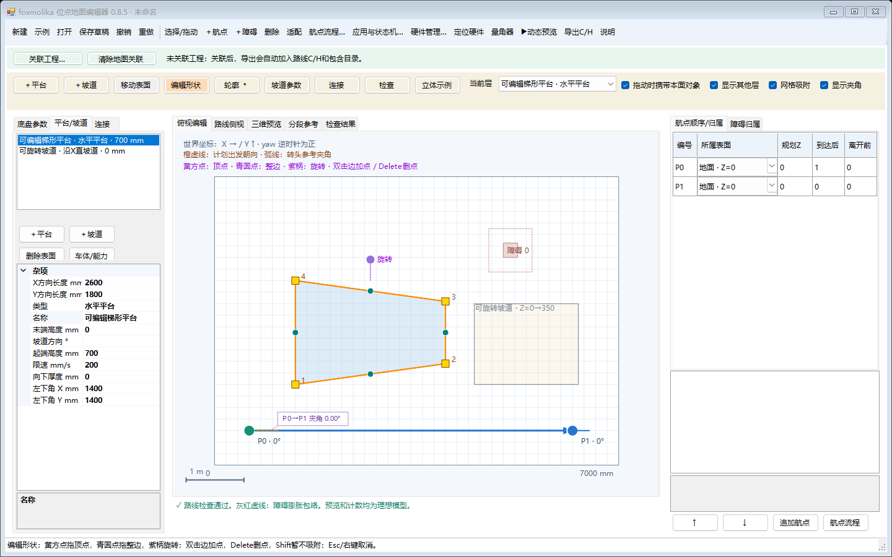
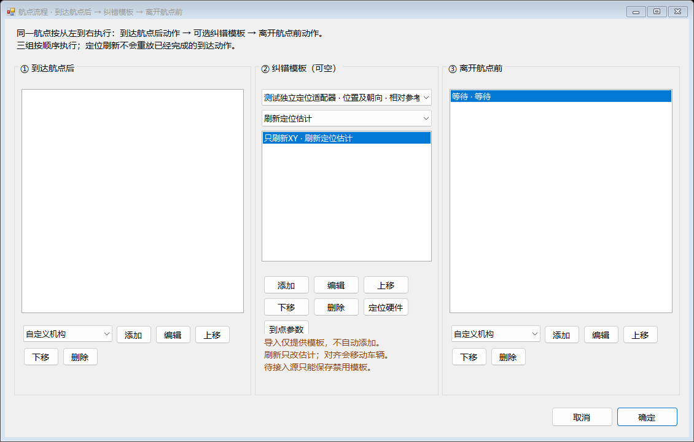
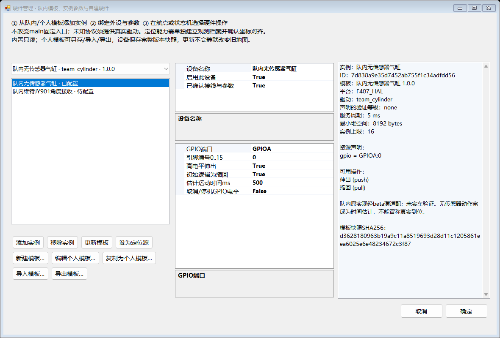
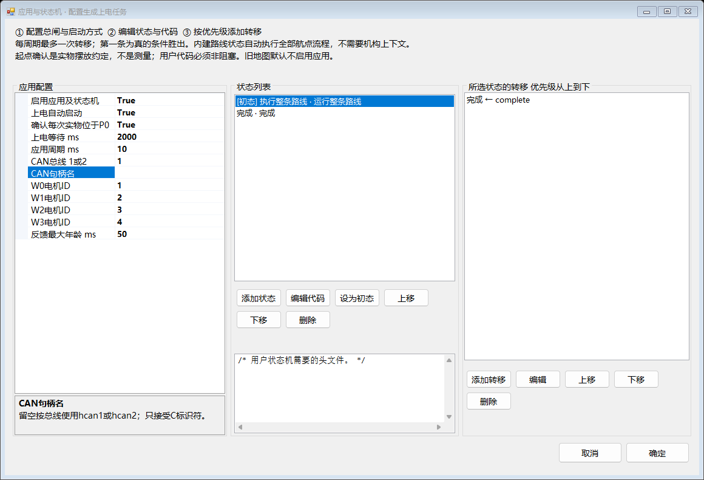

# foxmolika 用户手册

RCS 底盘与位点地图 · CubeMX 套件  
操作基线为 **0.8.8**。

一体安装器把底盘组件导入 CubeMX，同时安装地图编辑器与工程关联工具。CubeMX 生成板级初始化和底盘代码。地图编辑器根据保存的地图导出应用、路线和所选硬件驱动。Keil 编译两部分代码。

<a id="index"></a>

## 目录

- [第一次使用](#quick-start)
- [安装、覆盖修复与工程关联](#install)
- [编辑地图和航点动作](#map)
- [规划平台与坡道](#terrain)
- [接入硬件与定位纠错](#devices)
- [配置应用与状态机](#application)
- [导出、编译与接入 main.c](#build)
- [启动、停止与故障排查](#diagnostics)
- [迁移旧地图与工程](#migration)
- [历代更新](#history)

<a id="quick-start"></a>

## 第一次使用

先用一份 **STM32F407、HAL、Keil MDK-ARM** 工程副本跑通平地路线。仓库的原生验收环境为 CubeMX 6.18.1、STM32Cube FW_F4 V1.28.3 和 Arm Compiler 6.22。独立编辑器适合已经安装所需底盘包的电脑。

1. 运行 `foxmolika_CubeMX_Setup_<版本>_win-x64.exe`，确认日志显示底盘包已登记并通过文件校验。在安装器点击 **启动地图编辑器**，或从安装目录打开 `foxmolika_MapEditor.exe`。
2. 在 CubeMX 为工程启用 `Robotics / foxmolika` 组件和实际使用的 CAN 外设，保存并关闭 `.ioc`。在编辑器点击 **关联工程…** 选中该文件，再回 CubeMX 打开它并点 **Generate Code**。
3. 在编辑器点 **示例**，用 **底盘参数 → 导入 rcs_config.h** 读取本工程生成的配置。核对轮型、几何、减速比和方向，另存地图。第一条路线用平地 P0、P1，纠错组留空。
4. 打开 **应用与状态机…**，勾选 **启用应用及状态机**，先关闭 **上电自动启动**。保留 **运行整条路线 → 完成** 的流程。
5. 在编辑器里 **保存草稿 → 检查 → 导出C/H**，勾选 **导出到关联工程**。在 `main.c` 里一次性加入 [固定入口](#main-entry)，重载 Keil 工程并编译。
6. 接硬件试验时，先架空验轮和检查反馈。确认起点与运动条件后，用程序的显式启动入口开始执行。参见[启动与故障排查](#diagnostics)。

<a id="install"></a>

## 安装、覆盖修复与工程关联

| 要完成的事 | 操作 |
| --- | --- |
| 第一次安装或安装不同版本 | 用一体安装器选一个空目录，按提示选择本机 STM32CubeMX 位置。默认安装在 `%LOCALAPPDATA%/foxmolika_CubeMX_Suite_<版本>`。 |
| 修复同版本一体套件 | 关闭旧安装器、CubeMX、编辑器和关联工具。从下载目录运行修正版，选择原安装目录，点 **安装 / 修复**。旧的受管理文件备份到安装目录下 `.rcs-repair-backup-…`，缺失文件会补齐，另存的用户文件保留。 |
| 只安装或修复地图编辑器 | 使用 `foxmolika_MapEditor_Setup_<版本>_win-x64.exe`。首次安装或更换同号构建时可以选新空目录，底盘包由一体套件或 CubeMX 管理。 |

已登记且完整一致的底盘包可直接复用。安装器发现同版本的仓库文件内容冲突时会保留原包并停止，请核对使用的是哪个发行构建。安装文件占用时，关闭日志指出的程序后重试。

**每个工程主动关联一次。** 先在 CubeMX 的软件包或组件选择页勾选 `RCS.foxmolika` 对应版本，启用 `Robotics / foxmolika`，保存并关闭工程。随后从安装器或地图编辑器打开 **关联工程…**，选择该项目的 `.ioc`。关联工具会合并 `.extSettings`、登记工程内生成后助手，并备份被修改的工程配置。回 CubeMX 重新加载 `.ioc` 后再生成代码。

运动工程要核对实际 CAN1/2、引脚、位时序、终端、反馈 ID 和 RX0 中断，生成的中断处理函数应调用 `HAL_CAN_IRQHandler`。CAN2 项目还需核对 CAN1 时钟依赖和过滤器分组。当前自动运动接入以 C620 转子角反馈为基础，反馈 ID 为 `0x201–0x204`，每电机转 8192 计数。轮轴位移还要按实际减速比换算。

在 **底盘参数** 页导入生成的 `rcs_config.h` 后，再核对编码器计数、车体包络、轮组 ID 顺序与方向、CAN 句柄和 PID。应用周期须不小于速度环周期、在导航采样上限内，并小于命令超时。速度环 5 ms 和应用 10 ms 是仓库示例，实际配置按控制和反馈能力确定。启用应用运动前应配置并验证速度环，默认全零 PID 无法用于运动。

<a id="map"></a>

## 编辑地图和航点动作

地图文件扩展名为 `.rcsmap.json`。画布标注 X 向右、Y 向上，逆时针朝向为正。编辑器中的地图位置用毫米、朝向用度，应用层位姿接口用米和弧度。

1. **新建**或**打开**地图，在俯视图中选择 **当前层**。点 **＋航点** 后点击画布，可在选中航点之后插点，右下方 **追加航点** 用于在末尾新增。右侧的 **↑ / ↓** 调整顺序。
2. 在航点属性中设置所属表面、坐标、速度与起点朝向。点 **＋障碍** 在俯视图拖出矩形障碍，再检查所属表面与车体包络。临时断开的路线可保存草稿，生成代码前要通过完整检查。Ctrl+S 保存，Ctrl+Z 撤销，Ctrl+Y 重做。
3. 点 **显示夹角** 查看计划出发车头和下一段的夹角。要量一段的绝对方向，用 **量角器** 在画布依次选 A、B 两点，可交换方向，或把结果写入选定航点的旋转动作。



### 航点流程

选中航点，点 **航点流程…**。执行顺序为 **到点停稳 → 到达航点后 → 独立观测纠错 → 离开航点前 → 下一段**。两组动作各自排序，纠错重试时已经完成的到达动作不会重放。可选绝对或相对旋转、等待、自定义机构和已配置设备的操作。末点是否执行离开前动作由该点设置控制。



机构动作在启动、完成判断、清理与取消各阶段调用用户驱动。填写有限超时，使用非阻塞完成条件，并在取消分支撤销输出。内置等待和旋转无需机构上下文。动态预览可检查路线和阶段顺序，机构或观测的实际结果需要现场验证。

<a id="terrain"></a>

## 规划平台与坡道

1. 点 **＋平台**、**＋坡道**，设置各面的高度、厚度和限速。点 **编辑形状** 可拖顶点、边和旋转柄。轮廓需为 3–32 个顶点的凸多边形。点 **移动表面** 可以整体拖动，并按开关携带本面航点和障碍。Shift 临时取消吸附，Esc 或右键取消拖动，整次拖动可撤销。
2. 在 **连接** 页显式设置表面接合。连接边须等高且有正宽度，上下层投影重叠时要明确归属。目的航点默认 **沿连接表面**，经过的坡面和平台会形成内部几何分段。桥下路线可用 **保持起点层**，路径有歧义时填写入段表面链。
3. 用 **路线侧视**、**三维预览** 和 **检查** 核对净空、坡度、接边和车体包络。Z 由 XY 与表面模型计算。任务航点放在有足够过渡距离的水平区，坡面交界点由系统处理。进入坡道前先在水平区对齐，坡上仅沿坡轴前进或倒车。

要在实车执行，打开 **坡道参数**，填入实测过渡长度、可用减速度、横向和朝向容差，绑定真实驻坡回调并完成制动验证。回调签名为 `int Name(void *context, rcs_terrain_brake_request request)`。它要能非阻塞地响应 `CHECK` 和 `HOLD`。健康运行时应用按周期续期保持请求，硬件失电时仍需要独立的驻坡措施。

仓库的 `坡道执行示例.rcsmap.json` 与 `terrain_brake_port.c/.h` 展示参数和接入方式。实车使用前确认电机、驱动器、供电与制动能力。在导出结果中可通过 `rcs_terrain.c/.h` 确认已包含坡道模块。

<a id="devices"></a>

## 接入硬件与定位纠错

### 硬件模板与实例

打开 **硬件管理…**。可选内置模板包括队内无到位传感器气缸、队内 JY901、GPIO 输出和 PWM 舵机。选模板后点 **添加实例**，填写本机的句柄、引脚、极性、时间或脉宽，核对实际接线再勾选 **已确认接线与参数**。无传感器气缸按时间估计完成，JY901 需要配置 UART 与全局中断。



导入自有驱动时，可新建模板或复制内置模板，加入 C、H、C++ 文件和初始化、服务、停止、命令、完成等生命周期代码。个人模板包用 `.rcshw.json`，UTF-8 文件上限为 3 MiB。地图保留模板版本、摘要和参数快照。需要切换模板版本时显式点 **更新模板**，完成后重新确认参数。有航点、状态或定位引用时先解除引用再删除实例。

在航点动作或状态机里选择已配置设备的具体操作。对同一设备有严格顺序的两个目标各放在不同的动作或状态。编辑器会检查资源冲突，如独占 GPIO、UART、定时器通道及底盘同 CAN 的 `0x200` 发送帧。接入未知协议时需提供真实驱动，并明确归属总线资源。

队内 C++ 模板需要完整 C++ 库、至少 `0x2000` 堆和 Arm Compiler 6.22。配置 CubeMX 的 Heap Size 后重新生成，在 Keil 关闭 MicroLIB。工程登记工具会给硬件 C++ 文件添加所需的 `-fexceptions`。

### UART 和定时器回调

导出时，编辑器根据已启用设备的实际事件需求生成 HAL 回调。比如工程已有 CubeMX 的 TIM14 时基回调和个人 USART6 陀螺仪的 UART 回调，而地图中的设备由个人驱动自行处理接收，导出器会保留原有入口，避免重复定义。

- **个人 UART 驱动和内置 UART 设备共存**。在个人模板的 **UART 接收完成处理函数** 和 **UART 错误处理函数** 字段填入驱动中对应的函数名。驱动需提供可被外部调用的普通函数，签名为 `void Name(UART_HandleTypeDef *uart)`，C++ 文件内的函数使用 `extern "C"`。将原来的两个 HAL 全局回调改为这两个函数，保留函数体。模板声明一条独占 UART 资源，填入实际句柄，`OnUartRx` 留空。重新导入或更新地图内的模板快照后，生成器会按句柄分发；不同设备须使用各自的 UART。
- **CubeMX 的定时器时基和设备 `OnTimer` 共存**。标准 `Core/Src/main.c` 的 `USER CODE … Callback 1` 区会加入有标记的转发块。CubeMX 保留原来的 `HAL_IncTick()`，转发把原句柄交给设备钩子。钩子应先判断自己的定时器实例，再处理事件。重新生成后若提示转发块缺失，重新导出再构建。
- **工程已有多个强定义或回调归属不明确**。导出消息会列出已识别的回调及文件。根据提示保留一个入口并明确转发路径。检查参与当前 Keil 目标编译的源文件、模板快照和旧宏；宏展开或条件编译生成的入口仍需结合实际编译结果核对。

### 定位硬件与可选纠错

1. 无独立定位硬件时，保留空纠错组，路线由电机反馈做里程推算。
2. 有独立观测时，在 **定位硬件** 导入能力档案，或从 **硬件管理…** 将合适的设备设为定位源。完成真实驱动绑定、安装偏移换算和地图坐标对齐后，再确认启用。
3. 在 **航点流程… → 纠错模板** 选择刷新估计、XY 对齐或朝向对齐。仅按观测轴选功能，例如 JY901 提供朝向观测，XY 对齐需要独立 XY 数据。刷新估计只更新估计值，主动对齐会发出运动命令。

自有观测接口使用 `int Name(rcs_observation *sample)`。同一快照应给出采样序号、年龄、质量和有效轴，位姿以车体中心的地图坐标计，单位为米和弧度。序号只在真实采样时递增。样例档案与适配器默认待配置，缺轴、过期、回放或超过阈值均按故障处理。需要详细字段时可查[定位硬件接入](https://github.com/FoxMolika/Cubemx_RCS/blob/v0.8.4/docs/定位硬件接入.md)。

<a id="application"></a>

## 配置应用与状态机

从工具栏进入 **应用与状态机…**。启用应用，按工程填 CAN 总线与句柄、电机 ID、反馈最大年龄、应用周期和上电等待时间。默认状态表可从 **运行整条路线 → 完成** 开始。只用机构或等待的状态机可以不含路线状态，地图仍需至少两个合法航点。

图中是已确认 P0 的自动启动示例。第一次联调应将 **上电自动启动** 设为 `False`。



| 设置 | 生效时机 |
| --- | --- |
| 进入、离开 | 进入状态时执行一次，正常转移前执行离开代码。 |
| 周期 | 当前状态活动期间每个应用周期调用，用于推进非阻塞任务。 |
| 完成条件 | 自定义状态用 C 表达式，路线和等待状态分别按到达终点和设定时长完成。 |
| 转移 | 按列表顺序采用首条为真的条件，每周期最多一次，目标状态下个周期进入。可使用 `complete`、`elapsed_s` 和 `context`。 |
| 取消、超时 | 停止或故障时清理活动状态，超时进入故障。 |

一种常见流程是 **夹爪准备 → 运行路线 → 等待一秒 → 完成**。把夹爪驱动头文件放在公共包含区，在进入时发命令，完成条件读取驱动实际状态，转移条件写 `complete`。

路线自动启动需要勾选 **确认每次实物位于P0**，且每次上电前实物已位于 P0 并对齐起始朝向。首次联调保留手动启动，在程序中提供真实起点，再调用 `App_Start()`。全程保持 `App_Task()` 调度，并检查反馈与启动条件。

<a id="build"></a>

## 导出、编译与接入 main.c

1. 保存地图并修正 **检查** 中的问题。点 **导出C/H**，保留 **导出到关联工程**。需要交接或核对文件时可改用独立目录导出，随后自行集成。
2. 关联项目把应用与路线写入 `Application/foxmolikaRoute`，平地共 **19 个文件**，坡道多 `rcs_terrain.c/.h`，共 **21 个文件**。硬件驱动及其清单写入 `Application/foxmolikaHardware`，数量随设备变化。生成后助手会登记源文件、头文件和包含路径。
3. 在 Keil 重载已修改的 `.uvprojx`。若先导出时还没有 Keil 工程，回 CubeMX **Generate Code** 后再检查分组。后续修改地图时重新保存、导出并编译。构建前检查会核对地图修订与生成文件，避免编译旧路线。

| 文件 | 在哪里调整 |
| --- | --- |
| `rcs_config.h`、底盘 C/H | CubeMX 的 foxmolika 参数或工程的底盘配置。 |
| `app.c/.h`、`machism.c/.h`、`rcs_app_task.c/.h` | 固定应用入口、状态表和应用调度。任务流程优先在编辑器的 **应用与状态机…** 中调整。 |
| `rcs_route`、`rcs_nav`、`rcs_actions`、`rcs_terrain` | 航点、动作、地形以及导航配置。 |
| `rcs_can_port`、`rcs_feedback_port` 和应用配置头 | CAN 入口、轮子反馈和启动/观测配置。自定义分发器要与 CubeMX 的设置一致。 |

<a id="main-entry"></a>

### main.c 的固定接法

在 CubeMX 已有的三个 `USER CODE` 区中各加入对应内容。包含区加 `#include "app.h"`，在板级初始化完成后的 `USER CODE BEGIN 2` 检查初始化，在循环的 `USER CODE BEGIN 3` 运行任务。

```c
/* USER CODE BEGIN Includes */
#include "app.h"
/* USER CODE END Includes */

/* USER CODE BEGIN 2 */
if (!App_Init())
{
    Error_Handler();
}
/* USER CODE END 2 */

/* 在 CubeMX 原有的 while (1) 循环中 */
/* USER CODE BEGIN 3 */
App_Task();
/* USER CODE END 3 */
```

每次生成后保留这一套应用调度入口。RTOS 工程可把任务调用放进单个持续运行的任务，避免在主循环或回调中长时间等待。已有 `robot_route_task` 或自写底盘调度的工程要先确认分工，避免重复调度和同一 CAN 的两套接收者。

### 已有 CAN 回调或自定义接入

独占底盘反馈 FIFO 的新工程可用默认 `HAL_CAN_RxFifo0MsgPendingCallback`。有自己的全局分发器时，在编译宏中设 `RCS_CAN_PORT_DEFINE_HAL_CALLBACK=0`，在原有回调里调用 `rcs_can_port_poll(hcan)`，或由原分发器读出消息后逐帧调用 `rcs_can_port_on_rx`。两种方式选一种。共享总线时还要统一过滤器分配和非底盘消息的分发。

只集成底盘模块的工程可按板级接口直接接入 `RCS_Init`、`RCS_Process`、`RCS_Arm` 和 `RCS_OnCanRx`。这条路径由应用自己的任务负责调度。具体接口见[底盘接入说明](https://github.com/FoxMolika/Cubemx_RCS/blob/v0.8.4/docs/底盘接入说明.md)。

<a id="diagnostics"></a>

## 启动、停止与故障排查

试跑前核对每个逻辑轮的 ID、正反方向、零指令响应和反馈，再从低速短距离路线开始。手动启动时，初始化后用 `App_task_SetStartPose(x_m, y_m, yaw_rad)` 提供真实起点并继续调用 `App_Task()`。待反馈新鲜、前置条件满足，由操作者发出启动请求时调用 `App_Start()`。返回 1 表示应用接受本次启动，返回 0 时查看 `g_dbg` 与启动配置，修正条件后再发请求。

`App_Stop()` 会取消活动状态与动作，并禁止自动再次启动。故障处理后重新确认车位和停机条件，显式初始化、给定起点并启动。坡道上健康停车时观察保持请求，失联或失电需依靠现场制动措施。

| 现场现象 | 先查什么 |
| --- | --- |
| 安装报“访问被拒绝” | 先看安装日志给出的实际路径。检查工具目录、暂存父目录、CubeMX 仓库或注册目录是否可写，确认安装程序以普通用户的 Medium 完整性级别运行。 |
| “工程已有生成后操作” | 查看 `.ioc` 的 `ProjectManager.UAScriptAfterPath` 和它指向的实际文件。已知助手按路径和 SHA-256 校验。自定义操作先备份并按[迁移步骤](#migration)合并，保留工程依赖的生成步骤。 |
| `L6200E` 提示 HAL UART / TIM 回调重复 | 用 0.8.8 保存地图并重新 **导出到关联工程**。若以前临时加过 `RCS_HW_DEFINE_UART_CALLBACK=0` 或 `RCS_HW_DEFINE_TIMER_CALLBACK=0`，在工程副本中移除对应宏，重载 Keil 工程并完整重新编译。遇到导出冲突时按消息中的文件和回调名核对归属。 |
| Keil 缺少 C/H 或说路线不是最新 | 确认导出目标是当前关联工程，重新保存并导出地图。若分组缺失，重新 Generate Code 并重载工程。遇到未完成的硬件导出时，关闭占用工具，再在原导出位置重试以恢复。 |
| 编译提示缺 C++ 支持、UART 或 TIM | 核对所选模板与实际外设。重新生成 CubeMX 工程，确认 Keil 使用要求的编译器、运行库和堆配置。 |
| 一直停在 READY | 看应用总闸、起点确认、被标为必需的设备和各轮反馈年龄。Watch 中 `g_dbg.rx_count` 不增长时，先检查 CAN 位时序、过滤器、RX0 与回调。 |
| 收帧计数增加，接受帧数停住 | 同时观察 `g_dbg.feedback_sequence`、`port_fault` 和 `gap_us_max`。端口实时故障与应用首次快照不同。DWT 可用时按微秒查看同轮收帧空窗，并对照本工程的转速门限。 |
| 进入 FAULT 或坡道保护 | 记录 `app_fault` 以及 `feedback_fault`、`chassis_fault`、`nav_fault`、`machine_fault` 中的首发原因。核对 `loop_max_ms`、真实反馈、离线和制动条件，再按手动恢复流程处理。 |
| 编辑器崩溃或导出中断 | 先记录界面显示的实际报告路径。默认崩溃 ZIP 在 `%LOCALAPPDATA%/foxmolika/CrashReports`，草稿恢复副本可另存打开。分享诊断前核对其中的工程路径和内容。 |

`g_dbg` 供观察。可将其展开，一次查看应用状态、首次故障、位姿、各轮帧龄和主循环间隔。主机模拟、CubeMX 生成、Keil 编译和实车验证各有独立的验收记录。[调试变量与错误码](https://github.com/FoxMolika/Cubemx_RCS/blob/v0.8.4/docs/调试变量与错误码.md)

<a id="migration"></a>

## 迁移旧地图与工程

1. 复制工程与地图，先在副本内升级。使用过 `RCS.Chassis` 组件的项目，先在 CubeMX 取消旧组件，再选 `Robotics / foxmolika`，避免两套组件同时生成。
2. 在 CubeMX 选择 0.8.8 底盘组件，保存并关闭 `.ioc`，用本版 **关联工程…**。已知旧助手按路径与 SHA-256 校验，其中包括 0.8.4 正式版、原版 `084_alpha`、已登记的 0.8.5 修复构建和 0.8.7 助手。关联成功后助手位于 `foxmolika_Tools_088`。未知或手工改过的生成后脚本需要人工保留并合并，旧助手与备份可供比对。
3. 重新打开 `.ioc` 并 Generate Code。打开旧地图后另存，核对底盘参数和启动方式。旧地图应重新确认是否启用应用与硬件，尤其是自动启动和起点。
4. 对完整且签名有效的旧 **6/8** 或 **15/17** 文件生成目录可尝试升级到 **19/21**。编辑器会合并对应的 `USER CODE`。只有部分文件、生成区被手改、同一区有冲突或旧安全钩子被手改时，会提示保留原内容。此时先导出到独立空目录，再逐项合并并复核安全逻辑。
5. 在 Keil 重载、核对分组并编译。若旧 main 已接 `App_task_Init()`、旧导航任务或自写调度，按本版生成的 `app.h` 与[固定入口](#main-entry)检查调用链。

<a id="history"></a>

## 历代更新

版本标记和历史说明用来判断旧工程所处的功能阶段。较早条目中的文件数和入口对应当时的版本。正文按本手册顶部注明的基线操作。

| 版本 | 主要变化 |
| --- | --- |
| **0.8.8** · 本版 | 导出器根据设备需求处理 UART 和 TIM 回调。标准 CubeMX 定时器时基可与设备钩子共存，个人 UART 模板可指定处理函数并按句柄分发。补录原版 0.8.7 和已知 0.8.5 修复助手的 SHA-256。 |
| **0.8.7** | 生成后助手白名单改为从官方安装包提取 SHA-256。安装器、编辑器的“使用说明”统一为用户手册，版本记录移到手册末尾。[v0.8.7](https://github.com/FoxMolika/Cubemx_RCS/tree/v0.8.7) |
| **0.8.6** | 修复带任意硬件实例的地图无法保存/导出；内置 `team_spin8_gyro`（XS_spin8 连续航向）模板，支持必需传感器闸门与超时故障。[v0.8.6](https://github.com/FoxMolika/Cubemx_RCS/tree/v0.8.6) |
| **0.8.5** · PR | 一体安装器支持同版本原目录覆盖修复。支持原版 0.8.4 与 0.8.4.alpha 助手升级。硬件导出加锁并可继续清理中断事务，统一文件与模板大小上限，支持中文及含空格的路线和工程名。[PR #1](https://github.com/FoxMolika/Cubemx_RCS/pull/1) |
| **0.8.4** | 硬件管理引入模板、实例和快照，可生成队内气缸、JY901、GPIO、PWM 及自定义适配。设备快照采用地图 v8，硬件文件独立登记，取消设备归档。新增 `g_dbg`，DWT 微秒窗口修复高转速帧间隔误判，CAN 接收增加弱定义兜底。正式版统一去掉安装器和助手路径的测试后缀。[v0.8.4](https://github.com/FoxMolika/Cubemx_RCS/tree/v0.8.4) |
| **0.8.4.alpha / beta** · 开发版 | 正式版前的本地硬件模板、调试与构建阶段。早期工程中仍可见带后缀的生成后助手目录。[开发期变更审查](https://github.com/FoxMolika/Cubemx_RCS/blob/v0.8.4/docs/变更审查_0.8.4beta_调试接口.md) |
| **0.8.3.beta** · 开发版 | 引入可视化应用与状态机、固定 `App_Init/App_Task` 入口、状态转移和上电条件。应用配置采用地图 v7，加入 `app`、`machism` 后扩为平地 19 / 坡道 21 文件。[早期应用说明](https://github.com/FoxMolika/Cubemx_RCS/blob/v0.8.4/docs/0.8.3.beta使用说明.md) |
| **0.8.3** · 仓库历史提交 | 新增应用层任务、反馈与 CAN 端口，平地/坡道分别为 15/17 文件。启动等待新鲜反馈，未启用 CAN 时可编译无底盘接口。[应用层变更](https://github.com/FoxMolika/Cubemx_RCS/blob/v0.8.4/变更说明_0.8.3.md) |
| **0.8.2** | 发布绑定干净标签、Git 源码归档、验收与附件摘要，检查远端标签及实际文件名。新增 0.8.1 助手摘要迁移。[v0.8.2](https://github.com/FoxMolika/Cubemx_RCS/tree/v0.8.2) |
| **0.8.1** | 修复含文件或分组选项的 Keil 工程重复关联，保证只读取目标级选项。清除坡道复位残留故障，完善安装、导出和原子提交的受限重试，统一构建版本来源。[v0.8.1](https://github.com/FoxMolika/Cubemx_RCS/tree/v0.8.1) |
| **0.8.0** | 从地形几何扩展到标定坡道执行、前视限速和主动制动。平台和坡道可编辑凸轮廓。地图 v6，当时平地为 6 文件，坡道为 8 文件。[v0.8.0](https://github.com/FoxMolika/Cubemx_RCS/tree/v0.8.0) |
| **0.7.0** | 生成流程加入独立观测档案与可选纠错模板，可刷新估计、XY 对齐或朝向对齐，空组跳过。新纠错数据使用地图 v5。[v0.7.0](https://github.com/FoxMolika/Cubemx_RCS/tree/v0.7.0) |
| **0.6.1** | 航段可沿显式连接连续跨越多个表面，加入入段策略、表面链和桥下净空检查。当时立体功能用于几何规划。[v0.6.1](https://github.com/FoxMolika/Cubemx_RCS/tree/v0.6.1) |
| **0.6.0** | 平台、坡道、航点、连接和检查合进主窗口，共享保存草稿、恢复与撤销/重做。可在编辑过程中保留临时断开的连接。[v0.6.0](https://github.com/FoxMolika/Cubemx_RCS/tree/v0.6.0) |
| **0.5.2** | 修复安装程序 Low 完整性标签导致的拒写，核验 Medium 标签，加入目录和注册预检、诊断报告、安装互斥以及 CubeMX 临时目录隔离。[v0.5.2](https://github.com/FoxMolika/Cubemx_RCS/tree/v0.5.2) |
| **0.5.1** | 俯视图直接拖动平台和坡道，支持吸附、随面移动航点/障碍、取消和撤销。[v0.5.1](https://github.com/FoxMolika/Cubemx_RCS/tree/v0.5.1) |
| **0.5.0** | 到达与离开动作同时显示，加入平台/坡道、表面归属、接边、净空和立体预览。地图 v4，当时坡道用于几何规划。[v0.5.0](https://github.com/FoxMolika/Cubemx_RCS/tree/v0.5.0) |
| **0.4.1** | 地图可直接显示计划出发朝向和下一段夹角，补充角度绘制边界与开关。[v0.4.1](https://github.com/FoxMolika/Cubemx_RCS/tree/v0.4.1) |
| **0.4.0** | 航点执行改为阶段序列，加入双动作组、量角器、稳定动作 ID、地图 v3、崩溃 ZIP 和生成版本检查。[v0.4.0](https://github.com/FoxMolika/Cubemx_RCS/tree/v0.4.0) |
| **0.3.7** | 底盘与地图共用一次工程关联。地图记住工程，路线文件及包含路径可自动登记并在 CubeMX 再生成后恢复。[v0.3.7](https://github.com/FoxMolika/Cubemx_RCS/tree/v0.3.7) |
| **0.3.6** | 软件包、安装器和工具统一改用 foxmolika 名称，组件切换为 `Robotics / foxmolika`，保留公开 RCS 接口和地图兼容。[v0.3.6](https://github.com/FoxMolika/Cubemx_RCS/tree/v0.3.6) |
| **0.3.5** | 统一底盘和路径 C/H 的代码风格，CubeMX 与离线导出共用配置头约束，保留原动作用户区及自动登记流程。[v0.3.5](https://github.com/FoxMolika/Cubemx_RCS/tree/v0.3.5) |
| **0.3.4** | 关联工程时合并 CAN HAL 依赖，登记 CubeMX 生成后助手，自动补全 Keil 中的底盘头文件。[v0.3.4](https://github.com/FoxMolika/Cubemx_RCS/tree/v0.3.4) |
| **0.3.3** | 仓库最早标签。在 0.3.2 合并安装与事务恢复基础上加入非阻塞航点动作、`rcs_actions.c/.h`、按航点 ID 保留用户区及地图 v1→v2 迁移。[v0.3.3](https://github.com/FoxMolika/Cubemx_RCS/tree/v0.3.3) |
